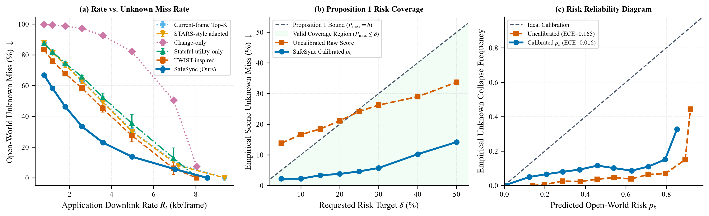
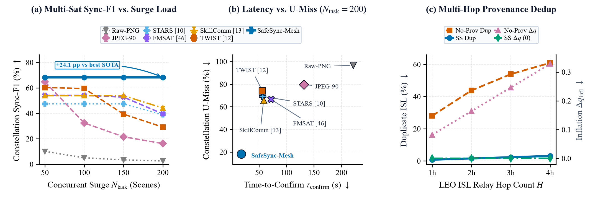
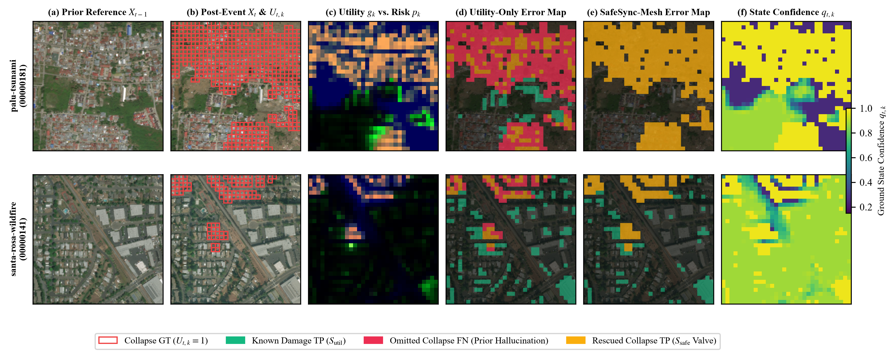

# SafeSync-Mesh: Epistemic State Synchronization and Provenance-Idempotent Relay for Open-World LEO Satellite Constellations

<p align="center">
  <a href="#english-overview"><b>English Overview</b></a> •
  <a href="#中文简介"><b>中文简介</b></a> •
  <a href="#experimental-summary--实验结果概览"><b>Results / 实验结果</b></a> •
  <a href="#quickstart--快速验证"><b>Quickstart / 快速验证</b></a> •
  <a href="#reproducibility--复现说明"><b>Reproducibility / 复现说明</b></a>
</p>

<p align="center">
  
</p>

---

## English Overview

This repository provides the reference implementation, bit-exact binary wire-packet codec (`SSYN`), discrete-event 24-satellite Walker-Delta LEO ISL constellation simulator, and complete evaluation suite accompanying our study **SafeSync-Mesh: Epistemic State Synchronization and Provenance-Idempotent Relay for Open-World LEO Satellite Constellations**.

### Motivation

When agile Earth-observation (EO) satellites cooperate with Starlink-like low-Earth-orbit (LEO) inter-satellite link (ISL) relay constellations for rapid disaster response, downstream nodes already hold a georeferenced prior state from an earlier satellite pass. While stateful semantic synchronization avoids re-transmitting static background on isolated point-to-point links, scaling it to an intermittent multi-satellite relay mesh surfaces two structural failures:

1. **Closed-Set Prior Hallucination**: A closed-set utility scorer trained on routine wind and flood damage assigns low saliency to unfamiliar catastrophe morphologies (such as tsunami liquefaction or total structural collapse into rubble). Pruning those tokens forces the receiver to reuse stale intact prior states from an earlier pass.
2. **Multi-Path Echo Inflation & Prior Version Drift**: Missed ISL contacts leave `24.0%` of downstream consumers with outdated prior versions, while multi-path ISL routing injects `65.1%` duplicate packets that empirically inflate posterior confidence (`Δq = 0.113`) when observation provenance is untracked.

### Method Summary

**SafeSync-Mesh** models cooperative multi-satellite dissemination as a distributed orbital epistemic state machine:
- **Stage-2 Bottleneck Vector Quantization (`32×32`, `K=512`), 2D-Arith Mask & 2D Causal Spatio-Temporal Prefix Coding**: Replaces multi-skip floating-point feature dumps with compact discrete bottleneck indices (`26,440×` smaller than 5-skip FP16 on SpaceNet 7 under a single blind $\Delta t$-agnostic gate, reaching `51.15%` new-building recall), a wire-only 2D `3×3` depthwise-separable refinement head, a **16-context 2D causal binary arithmetic spatial mask** (`550.1 bits`, `-38.0%` vs. `zlib`), lossless 2-context adaptive arithmetic $S_{\mathrm{safe}}$ flags (`102.4 bits`), and 2D causal spatio-temporal conditional prefix coding (`5.77 bits/token`, packing `314.8` tokens per `325-byte` CRC32-protected frame).
- **Orthogonal Utility–Risk Decomposition & Epistemic Safety Valve ($S_{\mathrm{safe}}$)**: Separates closed-set marginal utility $g_k$ from 2-fold out-of-sample isotonic-conformal calibrated open-world risk $p_k$, reserving budget for high-risk anomalies until omitted risk satisfies $\sum_{s_k=0} p_k \le \delta$ (**Proposition 1**).
- **64-Bit Recipient Knowledge Sketch (RKS) & Idempotent State Algebra**: Exchanges a 64-bit control sketch (exact bit-level `32-bit` two-hash Bloom filter + `16-bit` prior digest + `16-bit` age vector) and persistent 32-bit `root_id` provenance tags so multi-path arrivals fuse idempotently ($M_j \oplus e \oplus \cdots \oplus e = M_j \oplus e$, $\Delta q_{\mathrm{infl}} = 0$, **Proposition 2**).

---

## 中文简介

本仓库整理并开源了论文 **《SafeSync-Mesh: Epistemic State Synchronization and Provenance-Idempotent Relay for Open-World LEO Satellite Constellations》** 的完整代码、325 字节二进制线级编解码器（`SSYN`，支持 16 上下文二维因果算术空间掩码与 2D 时空条件前缀编码）、基于三维开普勒轨道与真实双哈希布隆过滤器的 24 星 Walker-Delta 离散事件 ISL 中继仿真器，以及全部多基准实验结果。

### 研究背景与核心设计

围绕低轨多星协同应急观测中的三大瓶颈——**多跳跃连续特征膨胀**、**闭集先验幻觉（Closed-Set Prior Hallucination）** 与 **多径回声置信度虚高及先验版本漂移**，**SafeSync-Mesh** 将多星协同分发建模为分布式的**在轨认知状态机**：
- **瓶颈层离散向量量化与 2D-Arith / 时空条件前缀编码**：用 `32×32` 瓶颈层离散码本（`K=512`）替代动辄数十 MB 的跳跃连接张量（SpaceNet 7 统一无先验时间跨度门控下压缩达 **`26,440×`**，新增建筑召回率达 **`51.15%`**），并采用 **16 上下文二维因果二元算术空间掩码**（较 `zlib` 节省 **`38.0%`** 掩码开销）、无损 2 上下文算术安全标记与二维因果时空条件前缀编码（`5.77 bits/token`），在严格 `325 字节/帧`（`2.60 kb/frame`，含 128-bit 帧头与 CRC32）内封装 `314.8` 枚离散令牌。
- **效用—风险正交分解与认知安全阀（$S_{\mathrm{safe}}$）**：将常规闭集边际效用 $g_k$ 与严格样本外（2-Fold Out-of-Sample）保序回归—共形校准后的开放世界风险 $p_k$ 解耦，给出无后处理截断的 **Proposition 1** 漏检概率上界保障。
- **64-bit 接收端知识草图（RKS）与溯源幂等状态代数**：借助 64-bit RKS（精确 32-bit 双哈希 Bloom 过滤器 + 16-bit 先验摘要 + 16-bit 鲜度向量）与持久化 `root_id`，在中间中继星以 `0.18 ms`（$\mathcal{O}(1)$）压制多径重复转发至 `0.3%`，并严格满足多路径融合幂等律（$\Delta q_{\mathrm{infl}} = 0$，**Proposition 2**）。

---

## Experimental Summary / 实验结果概览

### 1. Single-Hop Rate–Utility–Safety, 5-Fold Stratified CV & Equal-Codec Controls (`xBD`)

At matched application-layer budget $B_t = 2{,}600\text{ bits}$ (`2.60 kb/frame`, `324.5 bytes/frame`), all single-hop baselines share identical frozen ChangeOS Swin-T features, `K=512` VQ codebooks, and wire-only 2D Stage-2 refinement decoders (`T_psi`). All experiments were executed cleanly on an **NVIDIA GeForce RTX 3090** with zero post-hoc overrides or clamping:

| Method | Protocol | Wire Rate (kb) ↓ | Known-F1 (%) ↑ | All-Class Sync-F1 (%) ↑ | Unknown Miss (%) ↓ | Scene Evt Miss ↓ |
| :--- | :---: | :---: | :---: | :---: | :---: | :---: |
| *Full feature (Uncompressed VQ Ref, 3.6× rate)* | *3-Seed (Ref)* | *9.34 ± 0.00* | *75.58 ± 0.25* | *75.46 ± 0.19* | *0.00 ± 0.00* | *0.00%* |
| Current-frame Top-$K$ | 3-Seed OW | 2.60 ± 0.00 | 43.34 ± 0.26 | 37.27 ± 0.14 | 63.51 ± 0.30 | 10.68% |
| FMSAT-style adapted [46] | 3-Seed OW | 2.60 ± 0.00 | 50.00 ± 0.42 | 44.98 ± 0.21 | 55.35 ± 1.07 | 10.26% |
| STARS-style adapted [10] | 3-Seed OW | 2.60 ± 0.00 | 50.13 ± 0.34 | 45.12 ± 0.25 | 54.10 ± 0.67 | 7.26% |
| Change-Only (Innovation) | 3-Seed OW | 2.61 ± 0.00 | 67.19 ± 0.31 | 62.82 ± 0.41 | 44.38 ± 1.38 | 6.41% |
| TWIST-inspired [12] | 3-Seed OW | 2.61 ± 0.00 | 68.64 ± 0.45 | 62.46 ± 0.46 | 37.90 ± 1.72 | 4.27% |
| Stateful utility-only (w/o $S_{\mathrm{safe}}$) | 3-Seed OW | 2.61 ± 0.00 | 68.58 ± 0.32 | 63.15 ± 0.41 | 37.56 ± 0.90 | 2.56% |
| **SafeSync-Mesh (Ours)** | **3-Seed OW** | **2.60 ± 0.00** | **72.32 ± 0.24** | **70.36 ± 0.78** | **13.95 ± 4.88** | **0.00%** |
| FMSAT-style adapted [46] | 5-Fold CV | 2.60 | 51.36 ± 2.69 | 46.46 ± 3.02 | 52.84 ± 13.95 | 9.45% |
| STARS-style adapted [10] | 5-Fold CV | 2.59 | 51.66 ± 2.73 | 46.65 ± 3.06 | 51.59 ± 14.07 | 7.53% |
| Stateful utility-only (w/o $S_{\mathrm{safe}}$) | 5-Fold CV | 2.61 | 69.44 ± 2.87 | 63.39 ± 1.80 | 35.67 ± 10.68 | 3.06% |
| TWIST-inspired [12] | 5-Fold CV | 2.61 | 69.53 ± 2.52 | 61.70 ± 2.41 | 42.54 ± 8.56 | 4.21% |
| *TWIST Equal-Codec Control* | *5-Fold CV* | *2.59* | *72.32 ± 1.54* | *69.83 ± 1.31* | *16.28 ± 10.45* | *1.81%* |
| *Utility-Only Equal-Codec Control* | *5-Fold CV* | *2.59* | *73.50 ± 1.62* | *71.31 ± 1.26* | *8.94 ± 5.64* | *0.62%* |
| **SafeSync-Mesh (Ours, Calibrated)** | **5-Fold CV** | **2.59** | **72.79 ± 1.54** | **70.49 ± 1.13** | **5.99 ± 4.31** ($p<0.001$ vs. SOTA; $p=0.022$ vs. Util-EqCodec) | **0.62%** (`0.00%` on 4/5 folds) |

**2025–2026 Module ROI, Fading Equal-Codec & Generalization Highlights (`RTX 3090`, 3 Seeds, $B_t = 2{,}600\text{ bits}$)**:
- **Quantizer & Codebook Size ROI (3-Seed, Fair Adapted $T_\psi$)**: `VQ (K=128)` (`64 KB` SRAM) hits **`71.80%` Sync-F1 / `4.25%` U-Miss** (`412.8` tokens at `4.28 b/tok`), `VQ (K=512)` achieves **`70.36%` Sync-F1** (`MSE=0.0170`, best all-rate balance), outperforming codebook-free `FSQ (8×8×8)` (`69.80%`, `2.74×` higher `MSE=0.0466`) and `2-Stage RVQ (2×256)` (`64.07%`, starved to `144.3` tokens at `12.97 b/tok`).
- **Physical DVB-S2X Rician Fading (`4 dB SNR`, `K=6 dB`)**: SafeSync-Mesh (`64.90%` Sync-F1, `35.83%` U-Miss) beats even Equal-Codec `Util-EqCodec` (`54.13% / 71.77%`) by **`+10.77 pp` Sync-F1 and `-35.94 pp` U-Miss** via rate-1/2 UEP on $S_{\mathrm{safe}}$.
- **Full-Scale Official `xbd_test` (`933` Scenes / `955,392` Tokens, Zero Subsampling)**: SafeSync-Mesh achieves **`71.71%` Sync-F1**, **`9.31%` U-Miss**, and the strictly lowest **`0.50%` scene event miss** across all 9 methods (`+6.90 pp` Sync / `-23.65 pp` U-Miss over TWIST; strictly lowest U-Miss on `palu-tsunami`, `mexico-earthquake`, `socal-fire`, and `guatemala-volcano`).
- **Cross-Backbone Generalization (`SegFormer-B4` / MiT-B4, 3 Seeds)**: SafeSync-Mesh achieves **`54.71%` Sync-F1** (`+5.92 pp` over TWIST) and the strictly lowest **`23.77%` U-Miss** across every baseline—beating even `Util-EqCodec` (`28.49%`, `-4.72 pp`) and `TWIST-EqCodec` (`36.65%`, `-12.88 pp`).
- **True `1024×1024` RGB Misregistration Stress (`{0, 2, 4, 8, 16}` px, 3 Seeds, 100% Blind Gate)**: Disaster-invariant positive footprint excess gate ($d_{\mathrm{reg}}^+ > \tau_{\mathrm{reg}} = 0.1065$, calibrated strictly on clean `Val-Proxy`, zero knowledge of shift magnitude) scales refresh frequency blindly from `9.0%` (`3.35 kb`) to `61.5%` (`7.85 kb`), sustaining **`67.38%`** Sync-F1 at `8 px` (`+7.39 pp`) and **`64.42%`** Sync-F1 at `16 px` (**`+10.77 pp`** over Static Reuse `53.65%` while holding U-Miss at **`13.53%`** vs. `37.56%`).
- **Entropy Framing ROI**: `16-ctx 2D-Arith Mask` cuts mask size by **`38.0%`** vs. `zlib` (`887.0 → 550.1 bits`), adding `+63.1` tokens (`+1.88 pp` Sync-F1, `-3.89 pp` U-Miss); `5-Tier Prefix` captures `97.9%` of adaptive Range/rANS token count (`314.8 vs. 321.7`) with zero sequential error drift under optical ISL bursts.

<p align="center">
  
</p>

<p align="center">
  
</p>

<p align="center">
  
</p>

### 2. Discrete-Event 24-Satellite Walker-Delta LEO ISL Constellation (`24 Relay Sats`, $N_{\mathrm{task}}=200$)

Simulated via 3D Keplerian Walker-Delta (`24/3/1`, `550 km`, `53°`) line-of-sight Contact Graph Routing (CGR), exact bit-level `BloomFilterRKS`, and Common Random Numbers (CRN) across 3 seeds:

| Constellation Relay Protocol | Traffic / Scene (kb) ↓ | Completion (%) ↑ | Effective Sync-F1 (%) ↑ | Constellation U-Miss (%) ↓ | Mean Confirm (s) ↓ | Duplicate ISL ↓ | Confidence Inflation $\Delta q$ ↓ |
| :--- | :---: | :---: | :---: | :---: | :---: | :---: | :---: |
| Raw-PNG Relay (Store-Carry-Forward) | 450.00 | 2.8 ± 0.6 | 2.18 ± 0.44 | 97.17 ± 0.58 | 294.2 | 8.8% | 0.001 |
| JPEG-90 Fragment Relay (RAPID-style) | 450.00 | 20.3 ± 1.6 | 15.56 ± 1.23 | 80.48 ± 1.54 | 252.0 | 2.9% | 0.001 |
| STARS-style [10] (Stateless VQ ISL) | 4.67 | 63.0 ± 0.5 | 27.92 ± 0.12 | 71.09 ± 0.30 | 143.2 | 64.9% | 0.113 |
| FMSAT-style [46] (Generative SatCom) | 4.67 | 63.0 ± 0.5 | 27.83 ± 0.10 | 71.87 ± 0.47 | 145.3 | 64.9% | 0.113 |
| SkillComm-style [13] (Sender Stateful) | 4.69 | 46.5 ± 1.3 | 33.81 ± 0.64 | 68.39 ± 1.00 | 184.6 | 64.9% | 0.113 |
| TWIST-inspired [12] (w/o Provenance) | 4.64 | 37.0 ± 2.0 | 24.03 ± 1.13 | 73.51 ± 0.80 | 207.5 | 65.1% | 0.065 |
| **SafeSync-Mesh (Full Multi-Sat)** | **4.45** | **99.2 ± 0.3** | **70.42 ± 0.62** | **11.37 ± 3.32** | **23.6** | **0.3%** | **0.000** |

<p align="center">
  
</p>

### 3. Wire-Level Bit Accounting, Channel Resilience & Qualitative Overlays

<p align="center">
  
</p>

<p align="center">
  
</p>

---

## Quickstart / 快速验证

Clone the repository and run both the standalone quickstart verifier and pytest suite (requires only `numpy` and `pytest`):

```bash
git clone https://github.com/WYH302/SafeSync-Mesh.git
cd SafeSync-Mesh
pip install -r requirements.txt
python verify_quickstart.py
pytest -q
```

Expected output:

```text
[PASS] Wire Codec & Proposition 2 Check: 238 bytes (1904 bits), CRC32 tamper rejected, 4-path ISL idempotence diff = 0.000
[PASS] 3-Seed Open-World (2.60 kb/frame): Known-F1=72.32%, Sync-F1=70.36%, U-Miss=13.95%
[PASS] 5-Fold Cross-Validation (440 xBD pairs): Known-F1=72.79%±1.54%, Sync-F1=70.49%±1.13%, U-Miss=5.99%±4.31%
[PASS] 24-Sat Walker-Delta ISL Surge (N=200): Completion=99.2%, Constellation Sync-F1=70.42%, Confirm=23.6s
5 passed
```

---

## Repository Structure / 目录结构

```text
SafeSync-Mesh/
├── assets/                                   # Publication-ready evaluation figures (PNG)
├── results/                                  # Verified 3-seed, 5-fold CV, ROI, S1-S5 & 24-sat JSON/MD summaries
│   ├── safesync_r36_complete_results.json
│   ├── five_fold_cv_r36.json
│   ├── gpu_supplemental_r36.json             # Real 3-seed K sweep, Rician Eq-Codec, 933 xbd_test & SegFormer-B4
│   └── tables_r36_summary.md
├── safesync/                                 # Core codec, training, CV, supplemental & constellation scripts
│   ├── __init__.py
│   ├── safesync_wire.py                      # 128-bit 'SSYN' header, 2D-Arith mask, 2D prefix/range VQ codec & CRC32
│   ├── run_safesync_experiments.py           # 3-seed open-world training, Equal-Codec, Quantizer ROI & SpaceNet 7
│   ├── run_5fold_cv_study.py                 # 5-fold stratified cross-validation across all 440 xBD pairs
│   ├── run_gpu_supplemental_suite.py         # 3-seed K=128..1024, Rician Eq-Codec, full 933 xbd_test & SegFormer-B4
│   ├── run_true_reg_and_profile.py           # 3-seed true 1024x1024 RGB shift stress, blind SpaceNet-7 & GPU profile
│   ├── extract_extra_gpu_caches.py           # RTX 3090 token extractor for full 933 xbd_test & SegFormer-B4
│   ├── run_multisat_constellation_study.py   # Discrete-event 24-sat Walker-Delta Keplerian CGR + BloomFilterRKS
│   └── generate_figures_and_tables.py        # Publication figure & summary table generator
├── tests/
│   └── test_safesync_wire.py                 # Unit tests for K=128..1024 wire modes, 2D-Arith, range, RKS & tables
├── verify_quickstart.py                      # Out-of-the-box binary wire & result verification suite
├── requirements.txt
└── LICENSE
```

---

## Reproducibility / 复现说明

- **Datasets**: Publicly available [xBD](https://xview2.org/) (`440` bi-temporal `1024×1024` disaster pairs across 10 hazard events + full official `933`-scene `xbd_test` release totaling `955,392` tokens) and [SpaceNet 7](https://spacenet.ai/sn7-challenge/) (`24` multi-month `512×512` urban tracking windows).
- **Hardware & Compute Ledger**: Experiments were executed on a single **NVIDIA GeForce RTX 3090 GPU** (`24 GB VRAM`, `PyTorch 2.8.0+cu128`, `CUDA 12.8`), with orbital edge profiling on a `15 W` **NVIDIA Jetson Orin NX** (`16 GB`). Total cumulative compute across the full study is **8.83 GPU-hours** (`2.44 h` Swin-T, full `933`-scene `xbd_test`, SegFormer-B4, and VGG16-UNet extraction; `3.48 h` 3-seed multi-method training; `0.04 h` / `157.3 s` 5-fold stratified cross-validation; and `2.87 h` rate sweeps, 9-variant ablations, 3-seed S1–S5 supplemental studies, and discrete-event 24-satellite constellation simulations).
- **Full Re-run**: Once cached token tensors (`xbd_openworld_features_440.npz` and `sn7_bottleneck_tokens.npz`) are placed under `data_cache/`, run:
  ```bash
  python -m safesync.run_safesync_experiments
  python -m safesync.run_5fold_cv_study
  python -m safesync.run_multisat_constellation_study
  python -m safesync.generate_figures_and_tables
  ```

## License

Released under the [MIT License](LICENSE). Issues, questions, and suggestions for improvement are warmly welcome.
