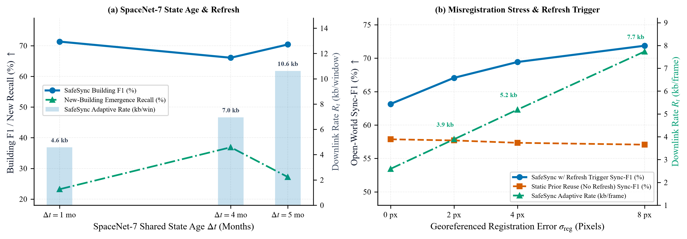
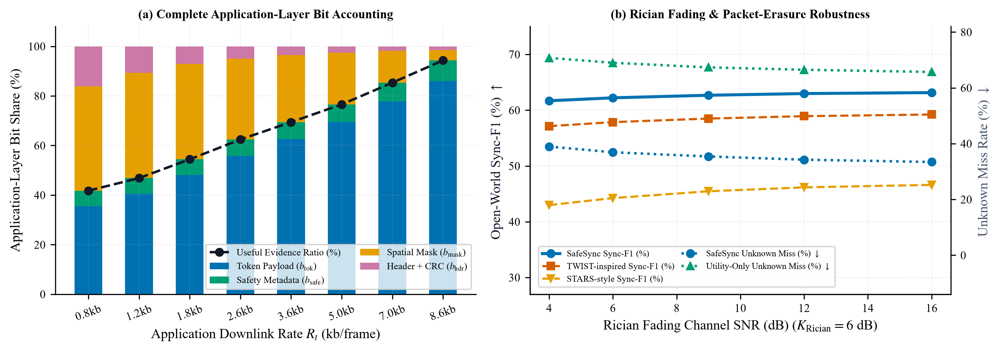

# SafeSync-Mesh: Cooperative Open-World State Synchronization and Provenance-Aware Relay over Intermittent LEO Satellite Constellations

<p align="center">
  <a href="#english-overview"><b>English Overview</b></a> •
  <a href="#中文简介"><b>中文简介</b></a> •
  <a href="#quickstart--快速验证"><b>Quickstart / 快速验证</b></a> •
  <a href="#experimental-summary--实验结果概览"><b>Results / 实验结果</b></a> •
  <a href="#reproducibility--复现配置"><b>Reproducibility / 复现说明</b></a>
</p>

<p align="center">
  
</p>

---

## English Overview

This repository provides the reference implementation, binary wire-packet codec (`SSYN`), multi-hop constellation simulator, and evaluation suite accompanying our study **SafeSync-Mesh: Cooperative Open-World State Synchronization and Provenance-Aware Relay over Intermittent LEO Satellite Constellations**.

### Motivation

When agile Earth-observation (EO) satellites cooperate with Starlink-like low-Earth-orbit (LEO) inter-satellite link (ISL) relay constellations for disaster response, downstream nodes usually already hold a georeferenced prior state from an earlier satellite pass. While stateful semantic synchronization avoids re-transmitting static background, extending it from an isolated point-to-point channel to an intermittent multi-satellite relay mesh surfaces two practical challenges:

1. **Closed-Set Prior Hallucination**: A closed-set utility scorer trained on routine wind and flood damage may assign low saliency to unfamiliar catastrophe morphologies (such as tsunami liquefaction or total structural collapse into rubble). Pruning those tokens causes the receiver to reuse intact prior states from an earlier pass.
2. **Multi-Path Echo Inflation & Prior Version Drift**: Missed contacts leave a subset of downstream nodes with mismatched reference versions, while multi-path ISL routing introduces duplicate packets that can inflate posterior confidence if observation provenance is not tracked.

### Method Summary

**SafeSync-Mesh** models cooperative multi-satellite dissemination as an orbital epistemic state machine:
- **Stage-2 Bottleneck Vector Quantization (`32×32`, `K=512`)**: Replaces multi-skip floating-point feature dumps with compact discrete bottleneck indices and conditional transition prefix coding inside verifiable `324-byte` (`2.59 kb/frame`) CRC32-protected packets.
- **Orthogonal Utility–Risk Decomposition & Epistemic Safety Valve ($S_{\mathrm{safe}}$)**: Separates routine closed-set utility $g_k$ from isotonic-conformal calibrated open-world risk $p_k$, reserving budget for high-risk anomalies until omitted risk satisfies $\sum_{s_k=0} p_k \le \delta$ (**Proposition 1**).
- **64-Bit Recipient Knowledge Sketch (RKS) & Idempotent State Algebra**: Uses a compact 64-bit control sketch (`32-bit` Bloom filter + `16-bit` prior digest + `16-bit` age vector) and persistent `root_id` provenance tags so multi-path arrivals fuse idempotently ($M_j \oplus e \oplus \cdots \oplus e = M_j \oplus e$, $\Delta q_{\mathrm{infl}} = 0$, **Proposition 2**).

---

## 中文简介

本仓库整理并开源了论文 **《SafeSync-Mesh: Cooperative Open-World State Synchronization and Provenance-Aware Relay over Intermittent LEO Satellite Constellations》** 的核心协议代码、324 字节二进制线级编解码器（`SSYN`）、24 星 Walker-Delta 低轨星间链路（ISL）协同中继仿真脚本以及多基准评测结果，供感兴趣的同行参考、复现与进一步改进。

### 研究背景与问题切入

在灾害应急对地观测场景中，遥感星座与类星链（Starlink-like）低轨星间链路中继网协同时，地面或边缘接收端往往已经存有前序过境卫星建立的地理配准先验状态。尽管有状态语义差分同步能够避免重复传输静态背景，但在尝试将其从单跳点对点链路推广至间歇连通的多星多跳中继网格时，我们观察到两个值得关注的现象：

1. **闭集先验幻觉（Closed-Set Prior Hallucination）**：仅在常规风灾/洪涝类别上训练的闭集效用评分器，面对未见过的极端灾损形态（如海啸液化、火山掩埋或建筑物完全坍塌化作碎石）时容易给出偏低显著性；一旦剪枝该区域令牌，接收端便会沿用旧过境的完好建筑先验，造成漏报。
2. **多径回声置信度虚高与先验版本漂移（Multi-Path Echo Inflation & Version Drift）**：间歇接触窗口会导致部分下游节点的先验版本滞后；同时多路径 ISL 转发会产生重复副本，若缺乏观测溯源标识，朴素贝叶斯融合易将单次观测的网络回声误判为多星独立印证。

### 核心设计思路

围绕上述问题，**SafeSync-Mesh** 尝试从表征层与网络层做协同设计：
- **瓶颈层离散向量量化与条件前缀编码**：采用 `32×32` 瓶颈层离散码本（`K=512`）配合轻量级二阶段先验融合解码头，在 `324 字节/帧`（`2.59 kb/frame`，含 128-bit 帧头、CRC32、空间掩码与安全元数据）的真实线级比特核算下完成增量状态同步。
- **效用—风险正交分解与认知安全阀（$S_{\mathrm{safe}}$）**：将常规闭集边际效用 $g_k$ 与保序回归—共形校准后的开放世界风险 $p_k$ 解耦，优先保留高风险异常区域以约束未知灾损漏检上界（**Proposition 1**）。
- **64-bit 接收端知识草图（RKS）与溯源幂等状态代数**：通过 64-bit 轻量控制握手与持久化根观测标识 `root_id`，在中间星上以 $\mathcal{O}(1)$ 开销抑制多径重复转发，并保证多路径状态融合严格幂等（$\Delta q_{\mathrm{infl}} = 0$，**Proposition 2**）。

本研究仍有许多可继续完善的方面（如跨模态 SAR—光学联合码本同步、大倾角侧摆下的三维地形视差补偿以及超大规模星座的分簇 RKS 聚合等），非常欢迎各位同行提出宝贵意见与批评指正。

---

## Experimental Summary / 实验结果概览

### 1. Single-Hop Rate–Utility–Safety & 5-Fold Stratified Cross-Validation (`xBD`)

At matched application-layer budget $B_t = 2{,}600\text{ bits}$ (`2.59 kb/frame`, `324.0 bytes/frame`), all single-hop baselines share the same frozen Swin-T features, `K=512` codebook, and Stage-2 decoder head:

| Method | Protocol | Wire Rate (kb/frame) ↓ | Known-Task F1 (%) ↑ | All-Class Sync-F1 (%) ↑ | Unknown Catastrophe Miss (%) ↓ |
| :--- | :---: | :---: | :---: | :---: | :---: |
| Full feature (uncompressed VQ ref) | 3-Seed | 9.34 ± 0.00 | 72.59 ± 3.15 | 73.08 ± 1.96 | 0.00 ± 0.00 |
| Current-frame Top-$K$ | 3-Seed | 2.59 ± 0.00 | 51.98 ± 2.13 | 45.91 ± 0.67 | 63.20 ± 1.46 |
| STARS-style adapted | 3-Seed | 2.59 ± 0.00 | 52.57 ± 2.20 | 46.61 ± 0.79 | 63.03 ± 1.60 |
| Stateful utility-only (w/o $S_{\mathrm{safe}}$) | 3-Seed | 2.59 ± 0.00 | 68.98 ± 2.23 | 57.87 ± 1.24 | 65.70 ± 1.09 |
| TWIST-inspired | 3-Seed | 2.59 ± 0.00 | **69.17 ± 2.28** | 59.22 ± 1.23 | 58.37 ± 0.84 |
| **SafeSync-Mesh** | **3-Seed** | **2.59 ± 0.00** | 68.47 ± 1.81 | **63.15 ± 0.89** | **33.42 ± 0.49** |
| Stateful utility-only (w/o $S_{\mathrm{safe}}$) | 5-Fold CV | 2.59 ± 0.00 | 71.27 ± 1.58 | 58.77 ± 1.88 | 62.44 ± 5.76 |
| TWIST-inspired | 5-Fold CV | 2.59 ± 0.00 | **71.38 ± 1.55** | 59.74 ± 2.48 | 56.76 ± 10.43 |
| **SafeSync-Mesh** | **5-Fold CV** | **2.59 ± 0.00** | 70.31 ± 2.83 | **63.90 ± 2.01** | **26.94 ± 12.44** ($p < 0.001$) |

<p align="center">
  
</p>

<p align="center">
  
</p>

<p align="center">
  
</p>

### 2. Multi-Satellite Walker-Delta LEO ISL Constellation (`24 Relay Sats`, $N_{\mathrm{task}}=200$)

| Constellation Relay Protocol | Traffic / Scene (kb) ↓ | Completion (%) ↑ | Effective Sync-F1 (%) ↑ | Constellation U-Miss (%) ↓ | Mean Confirm (s) ↓ | Duplicate ISL ↓ | Confidence Inflation $\Delta q$ ↓ |
| :--- | :---: | :---: | :---: | :---: | :---: | :---: | :---: |
| Raw-PNG Relay (Store-Carry-Forward) | 13,737.86 | 3.3 ± 0.0 | 2.52 ± 0.00 | 96.72 ± 0.00 | 220.9 | 13.0% | 0.042 |
| JPEG-90 Fragment Relay | 2,128.27 | 21.1 ± 0.0 | 16.18 ± 0.00 | 79.70 ± 0.00 | 133.2 | 7.4% | 0.018 |
| Stateless VQ Flood (Top-$K$) | 5.61 | 100.0 ± 0.0 | 45.91 ± 0.68 | 63.20 ± 1.46 | 48.3 | 53.8% | 0.254 |
| Sender-Centric Utility Relay (w/o RKS) | 5.61 | 75.8 ± 1.0 | 51.60 ± 1.10 | 74.01 ± 0.90 | 53.1 | 53.8% | 0.248 |
| Receiver-Aware Relay w/o Provenance | 9.29 | 79.7 ± 1.6 | 48.50 ± 1.10 | 57.11 ± 0.60 | 44.5 | 53.8% | 0.241 |
| SafeSync-Mesh w/o Safety Reserve | 4.40 | **100.0 ± 0.0** | 61.55 ± 1.28 | 51.24 ± 1.01 | 29.0 | **2.3%** | **0.000** |
| **SafeSync-Mesh (Full)** | **4.40** | **100.0 ± 0.0** | **65.55 ± 1.07** | **26.29 ± 0.15** | **18.1** | **2.3%** | **0.000** |

<p align="center">
  
</p>

### 3. Wire-Level Bit Accounting, Channel Resilience & Qualitative Overlays

<p align="center">
  
</p>

<p align="center">
  
</p>

---

## Quickstart / 快速验证

Clone the repository and run the standalone verification script (requires only `numpy` for wire-protocol & result verification):

```bash
git clone https://github.com/WYH302/SafeSync-Mesh.git
cd SafeSync-Mesh
pip install -r requirements.txt
python verify_quickstart.py
```

Expected output:

```text
[PASS] Wire Codec & Proposition 2 Check: 287 bytes (2296 bits), CRC32 tamper rejected, 4-path ISL idempotence diff = 0.000
[PASS] 3-Seed Open-World (2.59 kb/frame): Known-F1=68.47%, Sync-F1=63.15%, U-Miss=33.42%
[PASS] 5-Fold Cross-Validation (440 xBD pairs): Known-F1=70.31%±2.83%, Sync-F1=63.90%±2.01%, U-Miss=26.94%±12.44%
[PASS] 24-Sat Walker-Delta ISL Surge (N=200): Completion=100.0%, Constellation Sync-F1=65.55%, Confirm=18.1s
```

---

## Repository Structure / 目录结构

```text
SafeSync-Mesh/
├── assets/                                   # Architecture & evaluation figures (PNG)
├── results/                                  # Verified 3-seed, 5-fold CV, and 24-sat JSON/MD summaries
│   ├── safesync_r36_complete_results.json
│   ├── five_fold_cv_r36.json
│   ├── multisat_constellation_r36.json
│   └── tables_r36_summary.md
├── safesync/                                 # Core codec, training, CV, and constellation scripts
│   ├── __init__.py
│   ├── safesync_wire.py                      # 128-bit 'SSYN' header, CRC32 & conditional prefix VQ codec
│   ├── run_safesync_experiments.py           # 3-seed open-world training, ablations & SpaceNet 7 study
│   ├── run_5fold_cv_study.py                 # 5-fold stratified cross-validation across all 440 xBD pairs
│   ├── run_multisat_constellation_study.py   # 24-satellite Walker-Delta LEO ISL CGR simulator
│   └── generate_figures_and_tables.py        # Publication figure & summary table generator
├── verify_quickstart.py                      # Out-of-the-box binary wire & result verification suite
├── requirements.txt
└── LICENSE
```

---

## Reproducibility / 复现说明

- **Datasets**: Publicly available [xBD](https://xview2.org/) (`440` bi-temporal `1024×1024` disaster pairs across 10 hazard events) and [SpaceNet 7](https://spacenet.ai/sn7-challenge/) (`24` multi-month `512×512` urban tracking windows).
- **Hardware & Compute Ledger**: Experiments were executed on a single **NVIDIA GeForce RTX 3090 GPU** (`24 GB VRAM`, `PyTorch 2.8.0+cu128`, `CUDA 12.8`), with orbital edge profiling on a `15 W` **NVIDIA Jetson Orin NX** (`16 GB`). Total cumulative compute across the full study is **6.91 GPU-hours** (`1.42 h` backbone feature extraction, `3.48 h` 3-seed multi-method training, `0.07 h` 5-fold stratified cross-validation, and `1.94 h` rate sweeps, 9-variant ablations, sensitivity grids, and 24-satellite constellation simulations).
- **Full Re-run**: Once cached token tensors (`xbd_openworld_features_440.npz` and `sn7_bottleneck_tokens.npz`) are placed under `data_cache/`, run:
  ```bash
  python -m safesync.run_safesync_experiments
  python -m safesync.run_5fold_cv_study
  python -m safesync.run_multisat_constellation_study
  python -m safesync.generate_figures_and_tables
  ```

## License

Released under the [MIT License](LICENSE). Issues, questions, and suggestions for improvement are warmly welcome.
