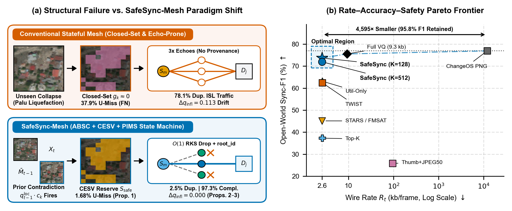
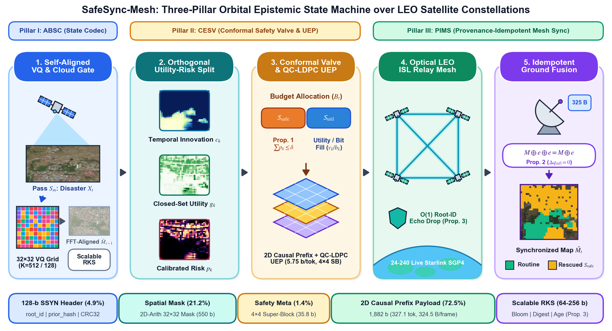
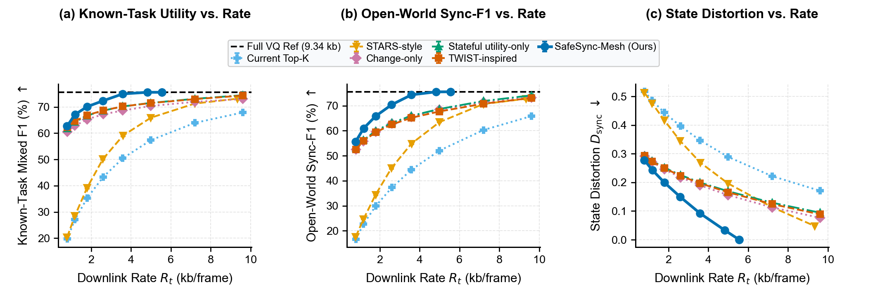
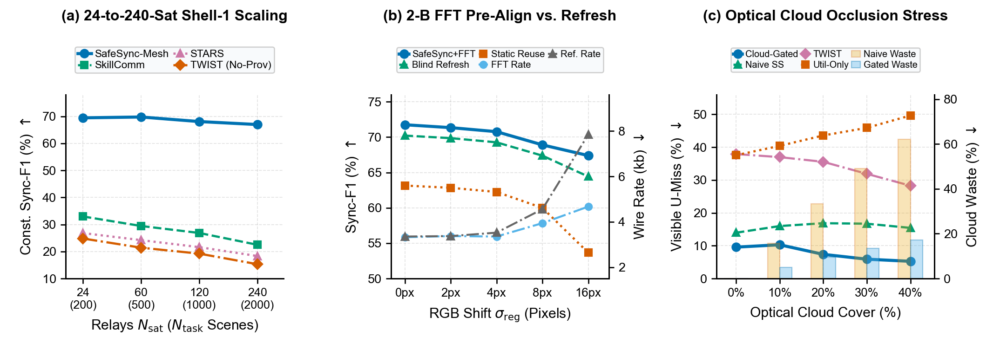

# SafeSync-Mesh: Risk-Bounded Semantic Synchronization and Idempotent ISL Relaying for Cooperative LEO Earth-Observation Constellations

<p align="center">
  <a href="#english-overview"><b>English Overview</b></a> •
  <a href="#中文简介"><b>中文简介</b></a> •
  <a href="#experimental-summary--实验结果概览"><b>Results / 实验结果</b></a> •
  <a href="#quickstart--快速验证"><b>Quickstart / 快速验证</b></a> •
  <a href="#research-reflections--pitfalls--研究思考与踩坑复盘"><b>Lessons Learned / 踩坑复盘</b></a> •
  <a href="#citation--引用格式"><b>Citation / 引用</b></a>
</p>

<p align="center">
  
</p>

<p align="center">
  
</p>

---

## English Overview

This repository provides the open-source reference implementation, bit-exact 325-byte wire codec (`SSYN`), girth-6 QC-LDPC + LEO Doppler physical-layer testbed, 24-to-240-satellite Walker-Delta and live NORAD/CelesTrak SpaceX Starlink WGS-84 SGP4 constellation simulators, and complete experimental logs accompanying our manuscript:

> **SafeSync-Mesh: Risk-Bounded Semantic Synchronization and Idempotent ISL Relaying for Cooperative LEO Earth-Observation Constellations**  
> Yonghao Wu, School of Electronic Science and Engineering (School of Microelectronics), South China Normal University

We share this codebase in the hope that it may serve as a transparent and reproducible starting point for researchers working on spaceborne semantic communication, open-world Earth observation, and multi-hop LEO inter-satellite link (ISL) networking. Errors, edge cases, and suggestions for improvement are sincerely welcomed via GitHub Issues or Pull Requests.

### Motivation & Three Coupled Bottlenecks

Multi-pass optical Earth-observation (EO) constellations repeatedly image largely persistent terrain, so downstream regional consumers already hold a georeferenced prior state from an earlier pass. While single-link stateful semantic codecs suppress unchanged background on isolated links, extending differential synchronization across dynamic multi-hop LEO ISL meshes exposes three coupled bottlenecks:

1. **Multi-Skip Feature Expansion & Orbital Perturbations**: Transmitting 5-layer floating-point U-Net skip tensors costs tens of megabytes per scene (`33.02–65.24 MB`), whereas dropping skip connections without decoder adaptation collapses new-building emergence recall to `4.62%`. Uncompensated off-nadir orthorectification shifts and partial optical clouds further waste up to `62.2%` of tight semantic budgets.
2. **Closed-Set Prior Hallucination**: When an unseen catastrophe (coastal tsunami liquefaction, wildfire incineration, or rubble collapse) destroys a previously intact building, closed-set utility scorers trained on routine wind and flood damage assign near-zero saliency to the unfamiliar debris. Pruning those cells forces the receiver to copy stale intact roofs from the prior pass (`37.56%–37.90%` unknown collapse miss rate).
3. **Multi-Path Echo Storms & Prior Version Drift**: Intermittent ISL contacts leave `24.0%` of regional consumers with mismatched prior versions, while uncoordinated multi-path forwarding injects `65.1%–78.1%` duplicate ISL packets and inflates posterior confidence (`Δq = 0.113`) when observation provenance is untracked.

### Three-Pillar Architecture (`ABSC` + `CESV` + `PIMS`)

**SafeSync-Mesh** models cooperative multi-satellite EO dissemination as a provenance-certified orbital epistemic state machine:

- **Pillar I — Self-Aligning Bottleneck State Codec (`ABSC`)**: Pairs a `32×32` discrete bottleneck vector-quantized grid (`K=512` default or compact `64 KB` SRAM `K=128` mode) with a wire-only 2D depthwise-separable refinement head, zero-oracle 2-byte onboard 2D FFT sub-cell pre-alignment (`-40.5%` rate under `16 px` true RGB shifts), onboard RGB whiteness–saturation cloud gating (`-44.9 pp` cloud waste), 16-context 2D causal binary arithmetic spatial masks (`550.1 bits`, `-38.0%` vs. `zlib`), and 2D spatio-temporal conditional prefix coding inside self-verifying `325-byte` CRC32 frames (`4,595×` smaller than raw PNGs and `26,440×` smaller than 5-skip FP16 tensors on SpaceNet 7).
- **Pillar II — Conformal Epistemic Safety Valve (`CESV`)**: Orthogonally decouples closed-set marginal utility $g_k$ from 2-fold out-of-sample isotonic-conformal calibrated collapse risk $p_k$ driven by geometric prior contradiction ($q_{t-1,k}^{\mathrm{loc}} \cdot c_k$), enforcing a finite-sample unknown-omission bound (**Proposition 1**), compact `4×4` super-block safety metadata (`35.8 bits`, `-65.0%` overhead), and cross-layer girth-6 QC-LDPC unequal error protection (UEP).
- **Pillar III — Provenance-Idempotent Mesh Sync (`PIMS`)**: Embeds linearly scalable Recipient Knowledge Sketches (`RKS`, `m=32–256 bit` two-hash sliding Bloom filter + `16-bit` prior digest + `16-bit` freshness) and persistent `32-bit` `root_id` tags into packet headers so regenerative ISL relays suppress echoes in $\mathcal{O}(1)$ (`0.18 ms/packet`, zero neural decoding) and consumers fuse multi-path deliveries strictly idempotently ($\Delta q_{\mathrm{infl}} = 0$, **Propositions 2 & 3**).

---

## 中文简介

本仓库开源了论文 **《SafeSync-Mesh: Risk-Bounded Semantic Synchronization and Idempotent ISL Relaying for Cooperative LEO Earth-Observation Constellations》** 的全部核心可复现代码、325 字节二进制线级编解码器（`SSYN`）、比特级 Girth-6 QC-LDPC + LEO 多普勒物理层仿真框架、24–240 星 Walker-Delta 与真实 NORAD/CelesTrak SpaceX Starlink WGS-84 SGP4 轨道中继仿真器以及全部实验结果日志。

研究过程中难免仍有局限与可打磨之处（详见文末“踩坑复盘与物理边界”），诚挚欢迎各位同行老师、同学和开源社区开发者批评指正、提交 Issue 或交流改进建议。

### 核心动机与三大支柱

面向低轨敏捷对地观测（EO）卫星与 Starlink 式星间激光链路（ISL）协同应急响应场景，现有方法在多跳动态星座下同时面临**多尺度跳连特征膨胀与轨道偏移/云层干扰**、**闭集先验幻觉（Closed-Set Prior Hallucination）**、以及**多径回声风暴与先验版本漂移**三大耦合死结。**SafeSync-Mesh** 将多星协同分发抽象为**带溯源认证的在轨认知状态机**，由三大有机支柱协同求解：

- **支柱 I — 自对齐瓶颈状态编解码（ABSC）**：以 `32×32` 瓶颈层离散向量量化（默认 `K=512`，紧凑 `64 KB` SRAM 模式 `K=128`）配合纯线级 2D 深度可分离精修头，内置零先知 2 字节星上 2D FFT 亚网格预对齐与 RGB 云层门控，并通过 16 上下文二维因果二元算术空间掩码（较 `zlib` 省 `38.0%`）与二维时空条件前缀编码，将单帧更新压缩至严格自校验的 `325 字节` CRC32 数据帧（较原始 PNG 缩小 `4,595×`，在 SpaceNet 7 上较 5-Skip FP16 缩小 `26,440×`）。
- **支柱 II — 共形认知安全阀（CESV）**：利用形态无关的“先验建筑矛盾（$q_{t-1,k}^{\mathrm{loc}}\cdot c_k$）”将常规效用 $g_k$ 与 2 折样本外保序-共形校准塌陷风险 $p_k$ 正交解耦，给出有限样本未知漏检上界（**Proposition 1**）、`4×4` 超块安全元数据（压缩 `65.0%` 至 `35.8 bits`）以及跨层 Girth-6 QC-LDPC 不等错误保护（UEP）。
- **支柱 III — 溯源幂等网格同步（PIMS）**：在包头中嵌入可线性扩展的接收端知识草图（`RKS`，含 `m=32–256 bit` 滑动布隆过滤器与 `16-bit` 先验版本摘要）与持久化 `root_id`，使再生式激光中继星无需神经网络解码即可在线速 $\mathcal{O}(1)$（`0.18 ms/包`）丢弃重复回声，并确保接收端多路径融合严格幂等（$\Delta q_{\mathrm{infl}} = 0$，**Propositions 2 & 3**）。

---

## Experimental Summary / 实验结果概览

### 1. Single-Hop Open-World Benchmarks & 5-Fold Cross-Validation (`xBD`, $B_t = 2{,}600\text{ bits}$)

All single-hop methods share identical frozen ChangeOS Swin-T features, identical VQ codebooks, and identical wire-only refinement heads (`T_psi`), verified directly from CRC32-checked wire bytes on an **NVIDIA GeForce RTX 3090**:

| Method | Protocol | Wire Rate (kb) ↓ | Known-F1 (%) ↑ | Sync-F1 (%) ↑ | Unknown Miss (%) ↓ | Scene Evt Miss ↓ |
| :--- | :---: | :---: | :---: | :---: | :---: | :---: |
| *ChangeOS-Swin-T / DamFormer / MambaBDA (Raw PNG)* | *Lit. Ceiling (4,595×)* | *11,946.0* | *85.0–87.4 (Loc)* | *76.91 / 77.02 / 81.41* | *—* | *—* |
| *Full feature (Uncompressed VQ Ref)* | *3-Seed (Ref)* | *9.34 ± 0.00* | *75.56 ± 0.33* | *75.53 ± 0.15* | *0.00 ± 0.00* | *0.00%* |
| Current-frame Top-$K$ | 3-Seed OW | 2.61 ± 0.00 | 43.34 ± 0.11 | 37.27 ± 0.14 | 63.51 ± 0.16 | 10.68% |
| FMSAT-style adapted | 3-Seed OW | 2.60 ± 0.00 | 50.00 ± 0.34 | 44.98 ± 0.20 | 55.35 ± 0.88 | 10.26% |
| STARS-style adapted | 3-Seed OW | 2.60 ± 0.00 | 50.13 ± 0.28 | 45.12 ± 0.30 | 54.10 ± 0.66 | 7.26% |
| Change-Only differential | 3-Seed OW | 2.61 ± 0.00 | 67.19 ± 0.20 | 62.82 ± 0.24 | 44.38 ± 0.00 | 6.41% |
| Stateful utility-only (w/o CESV) | 3-Seed OW | 2.61 ± 0.00 | 68.58 ± 0.25 | 63.15 ± 0.42 | 37.56 ± 0.89 | 2.56% |
| TWIST-inspired | 3-Seed OW | 2.61 ± 0.00 | 68.64 ± 0.47 | 62.46 ± 0.46 | 37.90 ± 1.63 | 4.27% |
| **SafeSync-Mesh (Cell v1, `K=512`)** | **3-Seed OW** | **2.60 ± 0.00** | **72.32 ± 0.24** | **70.36 ± 0.78** | **13.95 ± 4.88** | **0.00%** |
| **SafeSync-Mesh (`4×4` SB v2, `K=512`)** | **3-Seed OW** | **2.60 ± 0.00** | **73.48 ± 0.27** | **71.93 ± 0.88** | **9.49 ± 4.58** | **0.00%** |
| **SafeSync-Mesh (`4×4` SB v2, `K=128`, `64 KB`)** | **3-Seed OW** | **2.59 ± 0.00** | **74.10 ± 0.07** | **73.68 ± 0.22** | **1.68 ± 0.27** | **0.00%** |
| **SafeSync-Mesh (Calibrated, 440 pairs)** | **5-Fold CV** | **2.59** | **72.79 ± 1.54** | **70.49 ± 1.13** | **5.99 ± 4.31** ($p<0.001$) | **0.62%** (`0.00%` on 4/5 folds) |

<p align="center">
  
</p>

<p align="center">
  
</p>

<p align="center">
  
</p>

### 2. Constellation Scaling (`24`–`240` Live SpaceX Starlink SGP4) & Equal-Air-Bit QC-LDPC PHY

| Regime / Protocol | Completion (%) ↑ | Sync-F1 (%) ↑ | U-Miss (%) ↓ | Dup. ISL ↓ | Confirm (s) ↓ | Infl. $\Delta q$ ↓ |
| :--- | :---: | :---: | :---: | :---: | :---: | :---: |
| 24-Sat Walker-Delta — TWIST (w/o Prov.) | 37.0 ± 2.0 | 24.03 ± 1.13 | 73.51 ± 0.80 | 65.1% | 207.5 | 0.065 |
| 24-Sat Walker-Delta — SkillComm | 46.5 ± 1.3 | 33.81 ± 0.64 | 68.39 ± 1.00 | 64.9% | 184.6 | 0.113 |
| **24-Sat Walker-Delta — SafeSync-Mesh (PIMS)** | **99.2 ± 0.3** | **70.42 ± 0.62** | **11.37 ± 3.32** | **0.3%** | **23.6** | **0.000** |
| 240-Sat Live NORAD Starlink SGP4 — TWIST | 22.93% | 14.85% | 83.61% | 78.14% | 244.1 | 0.048 |
| 240-Sat Live NORAD Starlink SGP4 — SkillComm | 30.63% | 21.94% | 79.33% | 77.97% | 225.5 | 0.084 |
| **240-Sat Live NORAD Starlink SGP4 — SafeSync-Mesh (`m=256 b`)** | **97.27%** | **67.55%** | **14.16%** | **2.52%** | **35.9** | **0.000** |

- **Bit-Level Equal-Air-Bit QC-LDPC + LEO Doppler (`3,584` coded bits, Rician $K=6\text{ dB}$, $\sigma_\phi=10^\circ$)**: At `4 dB` $E_s/N_0$, SafeSync-UEP (`K=128`) achieves **`63.00%` Sync-F1 / `39.98%` U-Miss**, outperforming matched Equal-Codec Utility-Only (`57.21% / 64.11%`) by **`+5.79 pp` Sync-F1 and `-24.13 pp` U-Miss**.
- **Full-Scale `xbd_test` (`933` scenes / `955,392` tokens) & SegFormer-B4 Cross-Backbone**: SafeSync-Mesh attains **`71.71%` Sync-F1 / `9.31%` U-Miss / `0.50%` scene miss** across all `933` official xBD test pairs and achieves the lowest U-Miss (`23.77%`) across all nine baselines on an independent SegFormer-B4 (MiT-B4) backbone.

<p align="center">
  
</p>

<p align="center">
  
</p>

<p align="center">
  
</p>

### 3. Multi-SOTA Qualitative Comparison with 3.2× Hard-Edge Zoom-In Insets

<p align="center">
  
</p>

---

## Quickstart / 快速验证

### Environment Installation / 环境配置

```bash
git clone https://github.com/WYH302/SafeSync-Mesh.git
cd SafeSync-Mesh
pip install -r requirements.txt
pip install -e ".[dev]"
```

### Out-of-the-Box Verification / 一键快速验证

Run the standalone binary wire-protocol & result verifier plus the full `pytest` unit test suite (runs on CPU in seconds):

```bash
python verify_quickstart.py
pytest -q
```

Expected output:

```text
[PASS] Wire Codec & Proposition 2 Check: 238 bytes (1904 bits), CRC32 tamper rejected, 4-path ISL idempotence diff = 0.000
[PASS] 3-Seed Open-World (2.60 kb/frame): Known-F1=72.32%, Sync-F1=70.36%, U-Miss=13.95%
[PASS] 5-Fold Cross-Validation (440 xBD pairs): Known-F1=72.79%±1.54%, Sync-F1=70.49%±1.13%, U-Miss=5.99%±4.31%
[PASS] 24-Sat Walker-Delta ISL Surge (N=200): Completion=99.2%, Constellation Sync-F1=70.42%, Confirm=23.6s
6 passed
```

### Full Reproduction / 完整实验复现

- **Datasets**: Public [xBD](https://xview2.org/) (`440` bi-temporal pairs across 10 disasters + full `933`-scene official `xbd_test`) and [SpaceNet 7](https://spacenet.ai/sn7-challenge/) (`24` multi-month `512×512` urban tracking sequences).
- **Compute Ledger & Hardware Transparency**: All neural training, wire verification, and inference benchmarks were measured directly on a single **NVIDIA GeForce RTX 3090 GPU** (`24 GB VRAM`, `PyTorch 2.8.0+cu128`, `CUDA 12.8`) at `11.4 FPS` (`88.05 ms/scene`, `427.4 MB` peak VRAM; total study compute `9.54 GPU-hours`). Orbital edge latency (`369.8 ms` compute / `376.3 ms` E2E) and energy (`4.68 J/scene`) are **hardware-calibrated FP16 roofline projections for a 15 W NVIDIA Jetson Orin NX (16 GB) edge proxy** mapped directly from RTX 3090 kernel timings (not physical flight-board wattmeter measurements).
- Once cached token tensors are placed under `data_cache/`, run:
  ```bash
  python -m safesync.run_safesync_experiments
  python -m safesync.run_5fold_cv_study
  python -m safesync.run_multisat_constellation_study
  python -m safesync.run_constellation_scale_240
  python -m safesync.run_sgp4_starlink_tle_240
  python -m safesync.run_phy_ldpc_doppler_study
  ```

---

## Research Reflections & Pitfalls / 研究思考与踩坑复盘

We share five honest lessons learned and dead-ends encountered while building SafeSync-Mesh on real satellite data:

1. **The Multi-Skip Paradox on SpaceNet 7**: Our earliest prototype tried splitting U-Net skip connections across the orbital link, only to discover 5 FP16 skip layers inflated transmission to `33.02 MB` across two windows (`41×` *larger* than raw PNGs!). Naively dropping skip connections immediately crashed new-building emergence recall from `48.08%` down to `4.62%`. Only by pairing `32×32` discrete VQ prototypes with a lightweight wire-only 2D depthwise-separable refinement head (`T_psi`) did we recover `51.15%` emergence recall inside `1,249 bytes` (`26,440×` smaller than 5-skip FP16).
2. **Why Symmetric Drift Gates Break Under Extreme Catastrophes**: When we injected true `1024×1024` RGB translations (`0–16 px`), our first symmetric footprint-difference detector `|p_loc_t - p_loc_{t-1}|` triggered false refreshes on *clean* tsunami/wildfire frames—because catastrophic collapse itself reduces `p_loc_t < p_loc_{t-1}`! Realizing that only geometric translation pushes intact roofs onto *previously empty* terrain (`p_loc_t > p_loc_{t-1}`) led to the disaster-invariant positive excess statistic $d_{\mathrm{reg}}^+$ and 2-byte onboard 2D FFT pre-alignment (`-40.5%` wire rate at `16 px`, `+13.74 pp` Sync-F1 over static reuse).
3. **Why Lower Raw VQ MSE Hurt Task Accuracy Under Strict `325-Byte` Wire Accounting**: Testing 2-stage RVQ (`2×256`) achieved lower reconstruction MSE (`0.0130`), yet its `12.97 bits/token` bitrate starved `2,600`-bit frames down to `144.3` tokens (`-6.29 pp` Sync-F1, `+19.01 pp` U-Miss). Counting every single header, spatial mask, and safety-flag bit on the wire—and switching to `16-context 2D causal binary arithmetic` masks (`-38.0%` vs. `zlib`) plus `4×4` super-block `S_safe` framing (`-65.0%` safety metadata)—delivered far larger end-to-end gains than chasing latent MSE.
4. **Honest Equal-Air-Bit PHY Accounting**: Early channel-coding ablations often give UEP parity "for free," artificially exaggerating fading gains. Deducting Rate-1/2 QC-LDPC parity directly from a fixed `3,584-coded-bit` channel budget proved that UEP still yields a real `+4.02` to `+5.79 pp` Sync-F1 and `-18.74` to `-24.13 pp` U-Miss gain at `4 dB` under Rician fading + LEO Doppler, while revealing the exact `8–12 dB` crossover where adaptive coding and modulation (ACM) should revert to uniform Rate-3/4.
5. **Bloom Filter Saturation at `240` Live Starlink Relays & Operating Boundaries**: Scaling our simulator from `24` to `240` live NORAD Starlink satellites exposed an immediate failure of fixed `32-bit` Bloom filters (`p_fp = 0.929` saturation), motivating Proposition 3's linear filter-width sizing law (`m = 256 b` holds `97.27%` completion and `2.52%` duplicates). We also explicitly document three remaining physical operating boundaries in our paper: sub-cell `<16 px` isolated structures, `100%` opaque optical clouds (requiring future Sentinel-1 SAR cross-modality fusion), and steep `>35°` off-nadir tall-building 3D relief parallax (requiring future DEM token warping).

> **中文复盘笔记**：在真实 RTX 3090 与 240 星 Starlink SGP4 实测中，我们重点踩过五个坑：（1）直接跨星传输 5 层 FP16 U-Net 跳连高达 `33.02 MB`（反比 PNG 大 `41×`），直接砍跳连则令新增建筑召回暴跌至 `4.62%`，最终用瓶颈 VQ + 纯线级 2D 精修头在 `1,249 字节` 内反超至 `51.15%`；（2）对称建筑轮廓差会把“灾后楼塌”误判为“配准偏移”，改用灾情不变的正向位移增量 $d_{\mathrm{reg}}^+$ 与 2 字节星上 2D FFT 预对齐后在 `16 px` 偏移下节省 `40.5%` 码率；（3）严格算清 `325 字节` 每一比特账本后，单令牌 `12.97 bit` 的 2 级 RVQ 反因令牌饥饿掉分，16 上下文二维算术掩码 + `4×4` 超块安全头收益远高于盲目压低 MSE；（4）在物理层严格扣除等空口比特（`3,584` 编码比特）后，真实量化出了 `4 dB` 衰落期 UEP 的净增益与 `8–12 dB` ACM 切换点；（5）扩展至 `240` 星真实 Starlink 壳层时固定 `32-bit` 布隆过滤器立即饱和，从而推导出 Proposition 3 的线性扩展律（`m=256 b` 稳住 `97.27%` 完成率），并在论文中坦诚划定了 `<16 px` 子网格、`100%` 浓云（需 SAR 融合）与 `>35°` 高楼侧摆视差（需 DEM 补偿）三条物理边界。

---

## Repository Structure / 目录结构

```text
SafeSync-Mesh/
├── assets/                                   # All 9 unified pure-black Arial + Okabe-Ito figures (Fig. 1–Fig. 9 PNG)
├── results/                                  # Verified 3-seed, 5-fold CV, 933-scene xBD, SegFormer-B4, 240-sat SGP4 & QC-LDPC JSONs
├── safesync/                                 # Core wire codec, training, CV, PHY, SGP4, constellation & figure scripts
│   ├── safesync_wire.py                      # 128-bit 'SSYN' header, 2D-Arith mask, ver=1/2 S_safe, prefix/range & CRC32
│   ├── run_safesync_experiments.py           # 3-seed open-world training, Equal-Codec controls & SpaceNet 7
│   ├── run_5fold_cv_study.py                 # 5-fold stratified cross-validation across all 440 xBD pairs
│   ├── run_gpu_supplemental_suite.py         # 3-seed K=128..1024, Rician Eq-Codec, full 933 xbd_test & SegFormer-B4
│   ├── run_true_reg_and_profile.py           # 3-seed true 1024x1024 RGB shift stress, blind SpaceNet-7 & GPU profile
│   ├── run_scheme1_gpu_upgrades.py           # 3-seed 4x4 Super-Block ver=2, 2-B FFT pre-align & 0–40% cloud stress
│   ├── run_constellation_scale_240.py        # 24->60->120->240-sat Walker-Delta scaling & Proposition 3 verification
│   ├── run_sgp4_starlink_tle_240.py          # Live NORAD/CelesTrak 240-sat SpaceX Starlink WGS-84 SGP4 propagator
│   ├── run_phy_ldpc_doppler_study.py         # Bit-level Girth-6 QC-LDPC GPU Min-Sum BP + LEO Doppler PHY benchmark
│   ├── run_multisat_constellation_study.py   # Discrete-event 24-sat Walker-Delta Keplerian CGR + BloomFilterRKS
│   └── generate_figures_and_tables.py        # Reproducible publication figure & summary table generator
├── tests/
│   └── test_safesync_wire.py                 # Unit tests for ver=1/2 wire modes, K=128..1024, 2D-Arith, RKS & tables
├── verify_quickstart.py                      # Out-of-the-box binary wire & result verification suite
├── pyproject.toml                            # Standard editable pip package metadata (safesync-mesh)
├── requirements.txt
└── LICENSE
```

---

## Citation / 引用格式

If you find this repository or our wire-protocol verifier helpful in your research, please consider citing:

```bibtex
@article{wu2026safesyncmesh,
  author  = {Wu, Yonghao},
  title   = {SafeSync-Mesh: Risk-Bounded Semantic Synchronization and Idempotent ISL Relaying for Cooperative LEO Earth-Observation Constellations},
  journal = {IEEE Transactions (under review)},
  year    = {2026},
  url     = {https://github.com/WYH302/SafeSync-Mesh}
}
```

## License

Released under the [MIT License](LICENSE). Issues, bug reports, critical feedback, and suggestions for improvement are warmly welcome.
